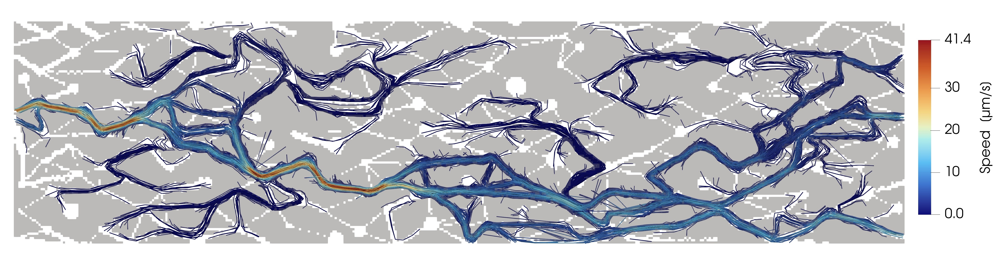

# Beyond bulk grade: mineral–flow accessibility at the pore scale

<p align="center">
  
</p>
<p align="center"><em>Connected flow through a two-dimensional pore network. Color traces inlet-connected paths; gray is the solid matrix. Copper recovery depends on whether chrysocolla sits next to these paths, not only on how much copper is present.</em></p>

[](LICENSE)
[](https://www.python.org/)
[](https://www.pflotran.org/)

Critical-mineral recovery is often inferred from **bulk grade**. Acid leaching, however, only dissolves mineral that reagent can reach through **connected pore space**. This repository is the open workflow behind a manuscript in preparation for *Environmental Science &amp; Technology*:

> Chakrawal et al., *Beyond Bulk Grade: Mineral–Flow Accessibility Controls Pore-Scale Copper Recovery*.

We treat chrysocolla in dilute sulfuric acid as a chemically simple copper-bearing example and isolate **geometry**. Twenty-five two-dimensional pore networks share nearly the same porosity and the same chrysocolla loading and kinetic surface area. What varies is how far that mineral sits from inlet-connected flow.

| Design | What is held / varied | *n* |
|--------|------------------------|-----|
| Set A | Factorial inlet pressure drop × intrinsic rate constant | 225 |
| Set B | Matched flushed pore volume (~11.6 PV in 48 h), three rates | 75 |
| **Ensemble** | Same 25 networks | **300** |

**Findings in brief.** At fixed bulk copper, solid-phase recovery still spanned about **9–21%** among networks. Recovery tracked how much acid-bearing fluid contacted the initially flow-adjacent copper, together with the dissolution rate. When each network received nearly the same leach volume, recovery still fell as the median mineral–pore distance *l<sub>r</sub>* increased. Péclet–Damköhler maps locate the transport–reaction regime; they do not collapse recovery by themselves.

Two pre-reaction metrics, computed on the initial pore–mineral map, make that geometry quantitative:

- **Accessible chrysocolla fraction** *f*<sub>Cu,acc</sub> — mineral within one voxel of inlet-connected pore space  
- **Reactive accessibility length** *l<sub>r</sub>* — median Euclidean distance from chrysocolla voxels to that pore space  

## What’s in this repository

| Path | Role |
|------|------|
| `src/` | Geometry construction, campaign drivers, and paper figures |
| `src/si_flow/` | Darcy–Stokes comparison and permeability checks (SI) |
| `darcy_vs_stokes/`, `2DStokes_FD/` | Flow solvers used in the SI |
| `accessibility_ensemble/` | Screening tables, analysis CSVs, and figure PNGs (not campaign HDF5) |
| `scripts/reproduce_figures.sh` | Rebuild manuscript figures from those products |
| `database/` | Aqueous speciation databases used by the reactive-transport decks |
| `assets/tracer.jpeg` | Hero figure above |

Reactive-transport **outputs** (`*.h5`, checkpoints, PFLOTRAN logs) are not stored here. They can be regenerated with PFLOTRAN if you need the full 300-run archive.

This repository is the **manuscript code snapshot**: Python, figure products, and flow solvers. It does not include HPC launchers, the Overleaf LaTeX tree, schematic Figs. 1–2, or PFLOTRAN HDF5 outputs.

## Repositories

| Repository | Role |
|------------|------|
| **[EMSL-Computing/copper_leaching](https://github.com/EMSL-Computing/copper_leaching)** | **This repo.** Public snapshot shipped with the manuscript. |
| [EMSL-Computing/multiphysics_modeling_agent](https://github.com/EMSL-Computing/multiphysics_modeling_agent) | Internal **development** remote (`arjun` and related work): campaigns, HPC, Overleaf submodule. Not what to clone for the paper. |

## Getting the code

```bash
git clone https://github.com/EMSL-Computing/copper_leaching.git
cd copper_leaching
```

Python 3 with NumPy, Matplotlib, pandas, and h5py is enough to rebuild figures. PFLOTRAN is required only if you re-run transport.

## Rebuild figures

From the repository root (does **not** re-run PFLOTRAN or re-screen geometries):

```bash
bash scripts/reproduce_figures.sh
```

| Figures | Command |
|---------|---------|
| Main recovery panels (3–7) and SI S2, S5–S8 | `python src/plot_accessibility_ensemble.py all-metrics` |
| SI Darcy–Stokes | `cd src/si_flow && bash run_tracer.sh plot --flow-only` |
| SI ensemble permeability | `python src/si_flow/plot_darcy_ensemble_perm.py` |
| SI screening map | Frozen; do not re-run `src/screen_l_r_ensemble.py` |

Step-by-step notes: [`src/REPRODUCE.md`](src/REPRODUCE.md).

Please cite the manuscript using [`CITATION.cff`](CITATION.cff).


## Contacts

| | Email |
|--|-------|
| Arjun Chakrawal | [arjun.chakrawal@pnnl.gov](mailto:arjun.chakrawal@pnnl.gov) |
| Maruti Kumar Mudunuru | [maruti@pnnl.gov](mailto:maruti@pnnl.gov) |
| Satish Karra | [karra@pnnl.gov](mailto:karra@pnnl.gov) |

Pacific Northwest National Laboratory, Richland, Washington, USA.

## Acknowledgments

This work was supported by **EMSL AI-Enabled Pore-Scale Modeling for Critical Mineral and Metal Applications**, part of EMSL’s [Bridging Soil Scales](https://www.emsl.pnnl.gov/bridging-soil-scales) science campaign. Environmental Molecular Sciences Laboratory is a DOE Office of Science User Facility sponsored by the Biological and Environmental Research program under Contract No. DE-AC05-76RL01830.


## DISCLAIMER
This material was prepared as an account of work sponsored by an agency of the
United States Government.  Neither the United States Government nor the United
States Department of Energy, nor Battelle, nor any of their employees, nor any
jurisdiction or organization that has cooperated in the development of these
materials, makes any warranty, express or implied, or assumes any legal
liability or responsibility for the accuracy, completeness, or usefulness or
any information, apparatus, product, software, or process disclosed, or
represents that its use would not infringe privately owned rights.
 
Reference herein to any specific commercial product, process, or service by
trade name, trademark, manufacturer, or otherwise does not necessarily
constitute or imply its endorsement, recommendation, or favoring by the United
States Government or any agency thereof, or Battelle Memorial Institute. The
views and opinions of authors expressed herein do not necessarily state or
reflect those of the United States Government or any agency thereof.
 
                PACIFIC NORTHWEST NATIONAL LABORATORY
                             operated by
                               BATTELLE
                               for the
                  UNITED STATES DEPARTMENT OF ENERGY
                   under Contract DE-AC05-76RL01830